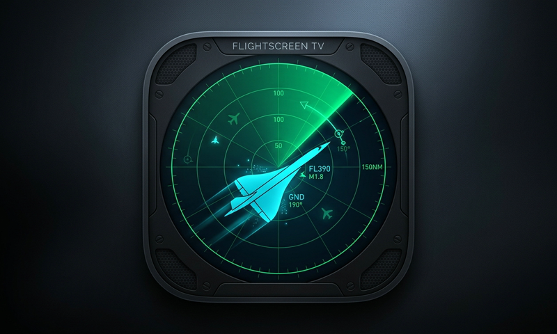

# FlightScreen TV for Apple TV (tvOS)

<p align="center">
  
</p>

<p align="center">
  <strong>Native Apple TV Live ADS-B Flight Radar & Ambient Cockpit Display</strong>
</p>

<p align="center">
  
  
  
  
  
</p>

---

## Overview

**FlightScreen TV** is a high-performance, native Apple TV (tvOS) live radar and flight-tracking screen designed for living room big screens, executive ambient monitors, and aviation enthusiasts.

Unlike web-wrapper ports, FlightScreen TV is engineered **100% natively in SwiftUI and MapKit** without WebKit. It features a decoupled, zero-allocation **60/120 FPS Canvas radar sweep overlay**, fluid Siri Remote touch navigation, and real-time live telemetry directly from open ADS-B feeds.

---

## Key Features

- **Hardware-Accelerated MapKit Engine**:
  - Smooth 4K vector map rendering natively integrated with Apple's Focus Engine.
  - One-click switching between **Dark Vector Map** (`.standard`) and **Satellite Hybrid** (`.hybrid`).
- **60 / 120 FPS Rotating Radar Sweep**:
  - Partitioned rendering architecture: static concentric distance rings (15, 30, 45, 60 NM), crosshairs, and typography are drawn once.
  - Real-time `TimelineView(.animation)` canvas rotates the gradient beam and sweep line with zero runtime memory allocations.
- **Live ADS-B Telemetry Feed**:
  - Direct async/await client polling from `api.adsb.lol` with automatic 15-second intervals.
  - JSON decoding and flight distance calculations offloaded to background threads.
  - Live altitude readout (`FL380`, `GND`), vertical speed (`↑ +1,800 fpm`), ground speed, track heading rotation, and squawk codes (including 7500/7600/7700 emergency alerts).
- **Glassmorphic Cockpit HUD & Target Card**:
  - Top cockpit telemetry pill displaying active hub, live airborne track count, radar radius, base map style, and connection status.
  - Asymmetric spring-animated detail card showing full flight telemetry for targeted aircraft.
- **Siri Remote Dual-Mode Ergonomics**:
  - **Map Mode (Default)**: Swipe across the Siri Remote touch surface to pan the map; tap Center Clickpad to cycle and inspect closest aircraft.
  - **Toolbar Mode**: Hold Center Clickpad or press **Play/Pause** (`⏯`) to access full controls (`[+ Zoom]`, `[− Zoom]`, `[🎯 Target/Station]`, `[🗺️ Map Style]`, `[📍 Station]`).
  - Pressing **Up** (`▲`) or **Back** (`<`) returns immediately to Map Mode.
- **Station Presets**:
  - Instant one-touch travel between major airspace hubs:
    1. **Ventura / LAX Basin**
    2. **San Francisco Bay**
    3. **Seattle / Tacoma**
    4. **New York / JFK**
    5. **Chicago O'Hare**
    6. **Denver Metro**

---

## Siri Remote Navigation Cheatsheet

| Remote Action | Map Mode (Default) | Toolbar Mode (Active) |
| :--- | :--- | :--- |
| **Touch Surface Swipe** | Continuous smooth map pan | — |
| **D-Pad Directional Click** | Step-by-step directional map pan | Navigate between buttons (`◀ ▶`) |
| **Center Clickpad Tap** | Target / cycle aircraft (closest first) | Execute focused button action |
| **Play / Pause (`⏯`)** | Open Toolbar Mode | Close Toolbar Mode |
| **Center Clickpad Hold (0.45s)**| Open Toolbar Mode | Close Toolbar Mode |
| **Back / Menu (`<`)** | Deselect targeted aircraft | **Exit Toolbar Mode & Return to Map** |
| **D-Pad Up (`▲`)** | Pan map north | **Exit Toolbar Mode & Return to Map** |

---

## Project Structure

```
appletv-flightscreen/
├── project.yml                       # Declarative XcodeGen project specification
├── FlightScreenTV.xcodeproj          # Generated native Xcode project
├── FlightScreenTV/
│   ├── App/
│   │   └── FlightScreenTVApp.swift   # tvOS SwiftUI App entry point
│   ├── Models/
│   │   ├── Aircraft.swift            # ADS-B aircraft data model & telemetry calculations
│   │   └── Station.swift             # Airspace radar station presets
│   ├── Services/
│   │   ├── AdsbService.swift         # Background network polling & JSON deserialization
│   │   ├── FlightScreenViewModel.swift# Camera state, pan throttling & remote actions
│   │   └── SiriRemoteManager.swift   # GameController Siri Remote touchpad bridge
│   ├── Views/
│   │   ├── ContentView.swift         # Root layout, gestures, and focus coordinator
│   │   ├── RadarMapView.swift        # MapKit background & aircraft annotations
│   │   ├── RadarSweepOverlay.swift   # 60/120 FPS Canvas radar sweep overlay
│   │   ├── AircraftMarkerView.swift  # Heading-oriented aircraft pins with callout badges
│   │   ├── TargetDetailHUD.swift     # Glassmorphic aircraft inspection HUD card
│   │   ├── TopHUDBar.swift           # Cockpit header bar
│   │   └── ToolbarControlsView.swift # Two-mode toolbar with tvOS focus states
│   └── Resources/
│       ├── Assets.xcassets/          # Layered 3D parallax tvOS AppIcon & accent colors
│       └── Info.plist                # tvOS bundle configuration
├── docs/
│   └── images/                       # Documentation assets
└── scripts/
    ├── build.sh                      # Unified CLI build script
    ├── deploy.sh                     # Wi-Fi auto-deployment to physical Apple TV
    └── generate-project.sh           # Project regeneration via XcodeGen
```

---

## Getting Started

### Prerequisites
- macOS 14.0+ with **Xcode 15+** (tested on Xcode 16 / tvOS 17+ SDK)
- [XcodeGen](https://github.com/yonaskolb/XcodeGen) (`brew install xcodegen`)
- (Optional) Physical Apple TV 4K or Apple TV HD paired with your Mac over local Wi-Fi

### 1. Clone the Repository
```bash
git clone https://github.com/aarzamen/appletv-flightscreen.git
cd appletv-flightscreen
```

### 2. Generate the Xcode Project
```bash
./scripts/generate-project.sh
```

> **Note on Code Signing**: By default, `project.yml` reads your Apple Developer Team ID from the `DEVELOPMENT_TEAM` environment variable or can be set directly in Xcode:
> ```bash
> DEVELOPMENT_TEAM="YOUR_TEAM_ID" ./scripts/generate-project.sh
> ```

### 3. Build & Run

#### Option A: Apple TV Simulator
```bash
./scripts/build.sh appletvsimulator "generic/platform=tvOS Simulator"
```

#### Option B: Deploy to Physical Apple TV
Ensure your Apple TV is paired with Xcode (**Window ➔ Devices and Simulators**), then run:
```bash
./scripts/deploy.sh
```
This script will build, sign with your active development profile, install over Wi-Fi, and launch FlightScreen TV directly onto your television screen.

---

## Privacy & Security

- **No Private Keys Stored**: Repository contains zero private keys, certificates, or personal authentication secrets.
- **Public ADS-B Data**: Network requests query the open, public `api.adsb.lol` telemetry endpoint.
- **Local Network Safe**: Device deployment commands use standard Apple `xcrun devicectl` commands over local mDNS discovery.

---

## License

This project is licensed under the [MIT License](LICENSE).
